# DQ Guardrail — Solution Architecture

| | |
|---|---|
| **Version** | 1.2 (revision 4, lifecycle split) |
| **Status** | Candidate for architecture approval |
| **Audience** | Domain architects, platform and SRE, data governance, security, investment committee |
| **Scope** | Runtime data-quality enforcement across HTTP APIs, Kafka and file processing on Kubernetes. Excludes remediation, master-data management and warehouse reconciliation. |
| **Governing invariant** | *One canonical object contract and one versioned rule pack produce one signed bundle, consumed by N interchangeable adapters.* |
| **Revision note** | Revision 2 closes the review findings: case for change (C4), transition roadmap (C2), artefact schemas (C3), validation and composition models (C1, H2), violation contract (H3), reference data (H4), quality model (H5), coverage SLI (H6), invariant tension (H7), and the decision-table weight and arithmetic defects (H1). |
| **Revision 3 note** | Aligned to the documentation conventions used for steering-committee papers: action title on every section and exhibit, quantified problem statement, value and investment case, consolidated risk register, operating model with RACI and forum cadence, NFR register, glossary and decision log. **No architectural content was removed.** |
| **How to read this** | Section 1 is the answer. Sections 2–3 are the design. Sections 4–9 are the case for approving it: value, resilience, governance, risk and sequence. Appendices carry detail for reviewers who want it. |
| **Revision 4 note** | Adds the publish/adopt distinction as an invariant (S7) and §7.8, and moves operational procedure — lifecycle transitions, propagation, suppression, queries — into the companion **Control Plane Operating Model** (D-011). This document remains normative for decisions; that one is normative for process. |
| **Companion documents** | [Control Plane Operating Model](control-plane-operating-model.md) — managing and disseminating objects and rules · [Delivery Design Pack](delivery-design-pack.md) — build contracts · [Data Plane Operations Guide](data-plane-operations-guide.md) — running it · [Steward quickstart](../steward-guide.md) — authoring a rule |

## Executive summary and case for change

**Recommendation.** Approve **KD-1**, **KD-2** and **KD-3** and fund **four engineer-weeks** (Waves M0–M2). They remove a defect class the business can already feel — three channels, three definitions of "valid" — without adding a service to the request path or a dependency to start-up. The benefit case below is stated as **definitions with confidence levels, not invented numbers**: quantifying it is the first output of the work, not the premise for approving it.

**The problem.** Three channels write the same business objects — HTTP services, Kafka producers and batch file drops — and each validates differently, or not at all. OpenAPI contracts and validation logic are owned by different teams in different repositories, so they drift, and the drift is discovered downstream in reconciliation rather than at the boundary. The recurring symptoms are familiar: high per-incident cost, no shared definition of "valid", and no way to answer the question *which rules applied to this record, and which version of them?*

**How large the problem is.** Six facts size the problem. Three are obtainable in a week from records that already exist and are the minimum needed for a funding decision; they should not wait for Wave M0.

| Dimension | Today | How it is obtained |
|---|---|---|
| Distinct implementations of "valid customer" | ≥ 3, one per channel | Repository scan, week 1 |
| Validation code that exists only to be retired | 2 of 3 implementations | Repository scan, week 1 |
| Escaped contract-or-rule defects, trailing 12 months | To be counted | Incident and change records, week 1 |
| Cost per escaped defect (rework + reconciliation + incident) | To be established | Finance and operations |
| Write paths that validate a business object | 3 channels, paths not yet enumerated | Write-path inventory, Wave M0 |
| Records validated per day at peak | To be measured | Platform metrics, Wave M0 |

The first three rows are the difference between an architecture review and a funding decision: they convert "we have a data quality problem" into "we carry N defects a year at cost C, and two of the three validators could be switched off".

**The answer.** Define each business object once, with both its syntax and its business semantics. **Prove at build time** that the contracts and the rules agree. **Publish** the result as a signed, immutable artefact. **Enforce** it in-process wherever a record enters the estate, through three thin adapters that share one engine and one rule bundle.

**Why now.** Four capabilities that required custom build five years ago are now commodity: OpenAPI 3.1 aligned with JSON Schema 2020-12, so one schema artefact can serve both the contract and the runtime; CEL established as the bounded expression language of the Kubernetes ecosystem; OCI plus Sigstore making rules a verifiable supply-chain artefact; and Envoy WASM and `ext_proc` enabling body-level enforcement without touching application code. The cost of delay is symmetric and compounding: every service shipped without enrolment is a retrofit, and retrofits are priced in application releases.

**What changes, and what it is worth.**

| Outcome | Measure | Target (baseline set in M0) |
|---|---|---|
| Defects caught at the boundary rather than downstream | Share of object defects rejected at ingest | ≥ 70% |
| One definition of "valid" instead of three | Rule sets maintained per business object | 1, across all channels |
| Contract-rule drift detected before release | Escaped drift incidents per quarter | 0 |
| Post-hoc answerability | Records traceable to a rule ID and bundle digest | 100% |
| Time to change a rule | Author-to-enforced | ≤ 1 day (from weeks) |

**What it costs.** Roughly four engineer-weeks to the first enforced, observable slice on one HTTP service (M0–M2 in §9); 50–150 µs added latency per request on the primary path; one OCI artefact and one small CRD as new operational surfaces; no new runtime service to page. Steady-state run cost is dominated by existing Envoy capacity.

**Decision requested.** Approve **KD-1** (option A primary, option C retained), **KD-2** (CEL), **KD-3** (OCI bundle plus binding CRD); fund **M0–M2**; and nominate one domain steward per business object for wave 1.

## Contents

- [Executive summary and case for change](#executive-summary-and-case-for-change)
- **1** · [Architecture in one page](#1-architecture-in-one-page)
- **2** · [Architectural views](#2-architectural-views) — [logical](#21-logical-application-view) · [data flow](#22-data-flow-view) · [security](#23-security-view) · [deployment](#24-deployment-view) · [consistency ledger](#25-view-consistency-ledger)
- **3** · [Key design decisions](#3-key-design-decisions) — [HTTP enforcement](#kd-1--http-enforcement-mechanism) · [rule language](#kd-2--semantic-rule-expression-language) · [distribution](#kd-3--rule-distribution) · [validation model](#validation-model-syntax-semantics-and-state) · [composition model](#composition-model-layering-by-intent) · [violation contract](#violation-contract-one-object-three-renderings)
- **4** · [Value, impact and investment](#4-value-impact-and-investment) — [adoption costs](#41-adoption-costs) · [value at stake](#42-value-at-stake) · [investment and payback](#43-investment-and-payback)
- **5** · [Availability, resilience and NFRs](#5-availability-resilience-and-nfrs) — [SLOs](#51-service-level-indicators) · [failure modes](#52-failure-modes-and-recovery) · [NFR register](#53-nfr-register-and-design-response)
- **6** · [System dynamics](#6-system-dynamics)
- **7** · [Single source of truth and governance](#7-single-source-of-truth-and-governance) — [invariants](#71-invariants) · [alignment layers](#72-alignment-layers) · [ownership](#73-ownership) · [quality model](#76-quality-model) · [operating model](#77-operating-model-and-decision-rights) · [lifecycle](#78-lifecycle-publish-adopt-retire)
- **8** · [Risks, assumptions and what would have to be true](#8-risks-assumptions-and-what-would-have-to-be-true) — [assumptions](#81-assumptions-and-open-items) · [risk register](#82-risk-register)
- **9** · [Transition roadmap](#9-transition-roadmap) — [waves](#91-work-packages-and-exit-criteria) · [calendar and value](#92-indicative-calendar-and-value-release) · [gates](#93-decision-gates)
- **A** · [Regenerating the figures](#appendix-a--regenerating-the-figures)
- **B** · [Related artefacts](#appendix-b--related-artefacts)
- **C** · [Artefact schemas](#appendix-c--artefact-schemas)
- **D** · [Glossary](#appendix-d--glossary)
- **E** · [Decision log](#appendix-e--decision-log)

---

## 1. Architecture in one page

**Answer: define each object once, prove at build time that its contract and its rules agree, then enforce the same signed rules in-process wherever a record enters — the only new surfaces are an OCI artefact and a small CRD.**

| Layer | What it is | Why it exists |
|---|---|---|
| **Define** | Business Object Registry in Git: JSON Schema 2020-12 plus metadata, value sets, and rule packs for objects and intents | Single source of truth for syntax **and** semantics |
| **Prove** | CI gate: Spectral, `dqctl align`, `dqctl test`, conformance replay | Contract-to-rule alignment becomes a build-time fact, not a review opinion |
| **Distribute** | Immutable cosign-signed OCI bundle, digest-pinned in a `QualityBinding` CRD | Rules ship as a supply-chain artefact; rollback is a digest revert |
| **Enforce** | One Go engine, three adapters: WASM (HTTP), stream gate (Kafka), gate job (file) | Same rules and same violation model on every medium |
| **Observe** | OpenTelemetry metrics and traces to dashboards, plus DataHub or OpenMetadata assertions | Scorecards per quality dimension, and a closed feedback loop |

**Addressing key.** `{intent}-{businessObject}` is the universal record address: a path segment for HTTP, the `dq.intent` and `dq.object` headers for Kafka, a manifest field for files. Because intent travels *on the wire*, rule composition is identical across mediums and no channel-specific rule logic exists.

**Why this is minimal.** No central runtime and no new request-path dependency: the engine is in-process, reads a pre-loaded signed bundle, and is bounded by construction. The only new operational surfaces are an OCI artefact and a small CRD.

---

## 2. Architectural views

**Answer: four views answer four different questions and one element ledger holds them together, so a reader moves between views without relearning the vocabulary — and an element cannot silently appear in one view and vanish from another.**

All views share one canonical element identifier set (`C1`–`C12`). An element that appears in more than one view appears **only** as its identifier, so a reader can move between views without re-learning vocabulary. The ledger in [2.5](#25-view-consistency-ledger) is the binding contract between the views.

### Figure index

| Fig | View | Action title — the conclusion the exhibit supports | Source | Rendered |
|---|---|---|---|---|
| 1 | Logical application | **One engine, three thin adapters: only C6 knows rule semantics, which is what keeps rules medium-independent** | `puml/fig1-logical-view.puml` | `figures/fig1-logical-view.svg` |
| 2 | Data flow | **Nine flows and one loop: F9 closes the feedback edge that stops the registry becoming a write-only archive** | this document | — |
| 3 | Security zones and trust boundaries | **Validating close to the writer keeps the payload inside the boundary that already owns it** | this document | — |
| 4 | Deployment | **Zero-touch enforcement adds an artefact and a CRD — not a service to page** | `puml/fig4-deployment-view.puml` | `figures/fig4-deployment-view.svg` |
| 5 | HTTP request validation | **ENFORCE terminates and SHADOW forwards; the same rule set drives both, so promotion is a config change** | `puml/fig5-http-request.puml` | `figures/fig5-http-request.svg` |
| 6 | Rule change lifecycle | **A rule change reaches production as a digest bump, not a release train** | `puml/fig6-rule-rollout.puml` | `figures/fig6-rule-rollout.svg` |
| 7 | Kafka produce, DLQ, replay | **Poison messages are contained before consumers see them, and remain replayable afterwards** | `puml/fig7-kafka.puml` | `figures/fig7-kafka.svg` |
| 8 | File gate job | **Acceptance is atomic: downstream never observes a partially validated file** | `puml/fig8-file.puml` | `figures/fig8-file.svg` |
| 9 | Contract and rule alignment gate | **Contract drift becomes a build failure rather than a discovery** | `puml/fig9-alignment-gate.puml` | `figures/fig9-alignment-gate.svg` |
| 10–13 | KD-1 options A–D | **Four interception points, one trade-off: runtime quality against coverage of writers** | `figures/kd1-opt-*.svg` | — |
| 14 | KD-2 rule language options | **Where the rule is evaluated sets the cost: in-process 10–50 µs, side hop hundreds of µs to milliseconds** | `figures/kd2-rule-language.svg` | — |

### 2.1 Logical application view

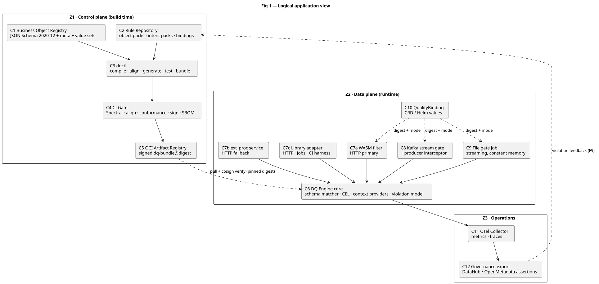

The three zones are separated by *change cadence*, not by technology: Z1 changes with governance approval, Z2 changes with a deployment, Z3 changes with an observability change. Component responsibilities, owners and cross-view placement are listed once in the [consistency ledger](#25-view-consistency-ledger).

**Two structural properties worth stating explicitly:**

- **C6 is the only component that knows the rule semantics.** Every adapter (C7a, C7b, C7c, C8, C9) is a thin transport shim that decodes the **record envelope** — intent, object and version, correlation ID — calls C6 with it, and renders a violation. This is what makes the rules medium-independent.
- **C5 → C6 is the only runtime dependency on the control plane**, and it is resolved once at start-up, not per request. Control-plane outages therefore cannot degrade request handling.

### 2.2 Data flow view

```
F1  Author      Steward edits catalog/*.json, catalog/*.meta.yaml, rules/**, bindings/**
F2  Prove       PR -> CI: Spectral -> dqctl align -> dqctl test -> compile -> sign -> push OCI
F3  Bind        Merge -> Argo CD applies QualityBinding (bundle digest + mode) to the workload
F4  Load        Pod start -> engine pulls bundle, verifies signature, caches it, emits DQ-Pack-Digest
F5  HTTP        Client -> Envoy (C7a) -> C6 -> forward 2xx | 422 problem+json
F6  Kafka       Producer (C8) -> topic -> stream gate (C8) -> .validated | .dlq
F7  File        Drop + manifest -> Argo step -> gate job (C9) -> accepted/ | rejects.csv | quarantine/
F8  Observe     C6 -> OTel (C11) -> Prometheus and Tempo -> dashboards -> C12 assertions
F9  Feedback    Violation report -> steward -> back to F1 (closes the control loop)
```

**Flow-to-component traceability.** Every flow names at least one canonical component; no flow crosses a zone without a declared mechanism.

| Flow | Producer | Components | Zone crossing | Versioned artefact |
|---|---|---|---|---|
| F1 | Steward | C1, C2 | Z0 → Z1 | Git commit |
| F2 | CI | C3, C4, C5 | Z1 → Z1 | Bundle digest `Dn` |
| F3 | Argo CD | C10 | Z1 → Z2 | Binding manifest |
| F4 | Engine | C6 | Z1 → Z2 | Pinned digest |
| F5 | API traffic | C7a or C7b or C7c, C6 | Z0 → Z2 | `DQ-Pack-Digest` |
| F6 | Stream traffic | C8, C6 | Z0 → Z2 | `dq.pack-digest` header |
| F7 | Batch | C9, C6 | Z0 → Z2 | Manifest digest |
| F8 | Engine | C11, C12 | Z2 → Z3 | Metric labels |
| F9 | Governance | C2 | Z3 → Z1 | Pull request |

**Design note on F9.** The feedback edge is what prevents the registry from becoming a write-only archive. Violation data flows back to the steward as evidence for rule change, but never writes to the registry directly — a human authors the change, keeping the registry reviewable.

### 2.3 Security view

| Zone | Contents | Trust level | Principal controls |
|---|---|---|---|
| **Z0** External | API clients, batch file drops, third-party producers | Untrusted | Edge TLS, OIDC or mTLS at the perimeter, WAF, rate limits |
| **Z1** Control plane | Git, CI runners, OCI registry | Highest — can change what is enforced | CODEOWNERS, two-person review, branch protection, CI workload identity, keyless cosign |
| **Z2** Runtime | Envoy and WASM, application pods, Kafka gate, gate jobs | Trusted, mTLS between workloads | Default-deny NetworkPolicy, distroless images, read-only root filesystem, non-root |
| **Z3** Operations | OTel, observability, governance catalogue | Read-only from Z2 | RBAC, no personal data in metric labels |

**Trust boundaries.** TB1 = Z0 → Z2 (perimeter). TB2 = Z1 → Z2 (bundle pull; the single runtime dependency on the control plane). TB3 = Z2 → Z3 (telemetry egress, no inbound).

| # | Threat | Vector | Control |
|---|---|---|---|
| T1 | Malicious rule bundle | Compromised CI or registry | cosign verification, digest pinning, admission policy on `verifyImages` |
| T2 | Personal data leaked in violations | Verbose error messages | `x-dq-sensitive` redaction; violations carry `path` and `ruleId` only |
| T3 | Engine denial of service | Catastrophic regex, CEL bomb | RE2 only, pattern length caps, `cel.CostLimit`, `maxRequestBytes` |
| T4 | Silent bypass | New route or framework not enrolled | Binding prefix coverage plus nightly route-drift reconciliation |
| T5 | Authority escalation | Someone relaxes a CRITICAL rule | `relax` requires justification and steward approval at compile time |
| T6 | Rule tampering | Write access to the rule repository | Rules are not secrets; tampering is detected by digest mismatch |

**Why payload validation sits close to the writer.** Placing validation in the central gateway would make the most privileged component read every customer record, expanding personal-data scope and the blast radius of any gateway misconfiguration. Per-service placement keeps the payload inside the pod that already legitimately owns it.

### 2.4 Deployment view

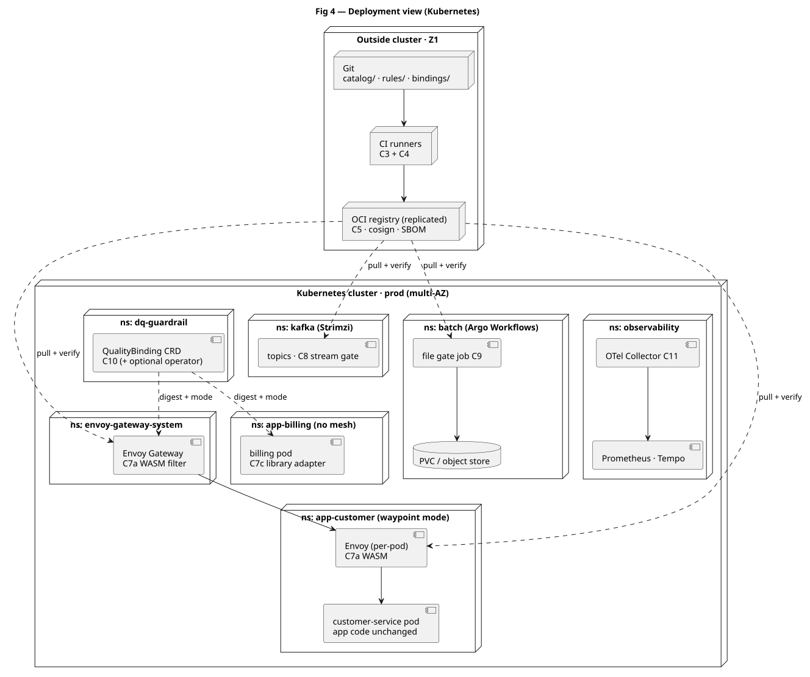

| Namespace | Purpose | DQ surface |
|---|---|---|
| `envoy-gateway-system` | North-south ingress | C7a WASM filter |
| `app-*` | Business services | C7a per-pod (mesh mode) or C7c library (no-mesh mode) |
| `dq-guardrail` | Binding and optional operator | C10 |
| `kafka` | Event backbone (Strimzi) | C8 stream gate |
| `batch` | Argo Workflows | C9 gate job, object store or PVC |
| `observability` | Telemetry and dashboards | C11 |

| Workload | Replicas | Requests | Limits | Notes |
|---|---|---|---|---|
| WASM filter (C7a) | per Envoy worker | — | 64 MB per worker | No extra pod; 5–20 MB typical |
| ext_proc (C7b, optional) | 3, HPA | 100m / 128Mi | 500m / 512Mi | Only for body streaming or response mutation |
| Kafka gate (C8) | 3, partition-bound | 500m / 512Mi | 1 / 1Gi | At least 3 partitions to match replicas |
| File gate job (C9) | 1 per file | 500m / 512Mi | 2 / 2Gi | Streaming; throughput to be benchmarked in M5 |
| Binding and operator (C10) | 1–2 | 50m / 64Mi | 200m / 256Mi | Operator optional in the first release |

**Disaster recovery.** The DR cluster differs only by OCI registry region and binding overlays; there is no stateful component to replicate. Bundle digests are pinned identically in both clusters, so the enforced rules are provably the same.

### 2.5 View consistency ledger

The transition mechanism between views is a single canonical element set. Any element appearing in more than one view appears **only** as its identifier.

| ID | Responsibility | Logical view | Data flow | Deployment | Zone | Owner |
|---|---|---|---|---|---|---|
| C1 | Canonical object schemas, metadata, value sets | Business Object Registry | F1, F2 | Git | Z1 | Domain steward |
| C2 | Object and intent rule packs, bindings | Rule Repository | F1, F9 | Git | Z1 | Domain architect |
| C3 | Compiler, aligner, test and bundle tool | dqctl | F2 | CI runner | Z1 | Platform |
| C4 | Alignment, lint, conformance, signing | CI Gate | F2 | CI runner | Z1 | Platform and Security |
| C5 | Immutable signed bundles | OCI Registry | F2, F4 | OCI (replicated) | Z1 | Platform |
| C6 | Schema matching, CEL evaluation, providers, violation model | DQ Engine core | F4–F8 | in-process, sidecar or job | Z2 | Platform |
| C7a | HTTP enforcement, zero-touch | WASM filter | F5 | Envoy Gateway and per-pod | Z2 | Platform and Network |
| C7b | HTTP enforcement, full body access | ext_proc service | F5 | Per-namespace (fallback) | Z2 | Platform |
| C7c | HTTP, Jobs and CI enforcement | Library adapter | F5–F7 | Application pod and CI | Z2 | Application team |
| C8 | Producer-side and stream validation | Kafka gate | F6 | `kafka` namespace | Z2 | Data platform |
| C9 | Batch file validation | File gate job | F7 | `batch` namespace | Z2 | Data platform |
| C10 | Digest and mode per workload | QualityBinding | F3 | CRD | Z2 | Platform |
| C11 | Telemetry aggregation | OTel Collector | F8 | `observability` namespace | Z3 | SRE |
| C12 | Assertions and scorecards | Governance export | F8, F9 | `observability` namespace | Z3 | Data governance |

**Consistency rules applied when this document changes:**

1. One identifier maps to exactly one responsibility; a new element requires a new identifier, never reuse.
2. Every flow in [2.2](#22-data-flow-view) names at least one identifier.
3. No element may appear in the deployment view without a logical-view entry, and vice versa.
4. Visual legend is identical in all rendered figures: blue = control plane, teal = data plane, grey = external, red = rejected or uncovered path.

---

## 3. Key design decisions

**Answer: zero-touch enforcement is the right primary mechanism and it is not sufficient on its own — at equal coverage weighting the two leading options tie, which is why both are retained rather than one chosen.**

Two criterion sets are used, because two different questions are being decided. Within any table the weights sum to 100%, and the fifth criterion — the one that differs between the two sets — is marked in the row label.

| Criterion set | Used for | Weights |
|---|---|---|
| **Mechanism** | KD-1 (where to enforce) | coverage and time-to-value 25%, maintainability 20%, resilience 20%, performance 20%, security 15% |
| **Technology** | KD-2, KD-3 (what to build on) | ecosystem and portability 25%, maintainability 20%, resilience 20%, performance 20%, security 15% |

The rationale for the difference: a *mechanism* is judged on how much of the estate it covers and how fast it can be adopted; a *technology* is judged on whether it will still be supported and staffed in five years, since it is far more expensive to replace. Scores are 1–5, where 5 is most favourable. Totals are the weighted arithmetic mean and are reproducible from the rows as printed; a sensitivity check follows KD-3.

### KD-1 · HTTP enforcement mechanism

| Row | **A · Envoy WASM filter** | **B · ext_proc sidecar** | **C · Library middleware** | **D · Managed gateway policy** |
|---|---|---|---|---|
| **Description** | DQ engine compiled to proxy-wasm and executing inside Envoy, at the gateway or in a per-pod waypoint. Reads the body and returns a violation response. | Envoy calls an external gRPC service per request using `ext_proc`; that service hosts the engine. | Framework middleware (Go handler, Spring filter, FastAPI dependency) links the engine into the application process. | Rules expressed in a vendor policy language at the central API gateway. |
| **Pros** | • Zero application change and zero extra pod.<br>• **Impact:** onboarding is a single binding pull request.<br>• Topological coverage: a newly added route cannot be forgotten.<br>• **Impact:** eliminates the "unregistered endpoint" defect class.<br>• 50–150 µs with no network dependency.<br>• **Impact:** no new single point of failure in the request path. | • Zero application change.<br>• **Impact:** same onboarding economics as A.<br>• Full request **and response** body access, with streaming and mutation.<br>• **Impact:** enables response masking and very large payloads.<br>• Debuggable as an ordinary service with logs and traces.<br>• **Impact:** shortest mean time to repair for rule defects. | • 30–80 µs with no buffering limits.<br>• **Impact:** covers writers no proxy can see: Jobs, stream processors, CI harness.<br>• Best developer experience; `dqctl test` runs without a cluster.<br>• **Impact:** faster iteration yields better rules. | • No new component where a gateway is already owned.<br>• **Impact:** lowest build cost and fastest procurement.<br>• Central authoring model familiar to network teams. |
| **Cons** | • Hard to debug: faults surface inside Envoy, mostly as statistics.<br>• **Impact:** roughly one extra day per incident, requiring specialist skills.<br>• Body size caps cause silent bypass when misconfigured.<br>• **Impact:** the largest payloads escape validation exactly when they matter most.<br>• Envoy and WASM ABI churn; JSON only. | • 0.5–1.5 ms p99 from two loopback hops plus gRPC framing and body copy.<br>• **Impact:** measurable on chatty services; capacity review required.<br>• One extra pod per workload at about 50 MB.<br>• **Impact:** roughly 25 GB cluster-wide at 500 pods.<br>• Streaming and flow-control edge cases become yours. | • Opt-in: silently absent wherever not adopted.<br>• **Impact:** creates a false sense of control; requires a drift detector.<br>• Rule change requires rebuild and redeploy across N teams.<br>• **Impact:** repair time measured in days.<br>• N framework integrations to maintain. | • Front door only: no east-west, no Kafka, no files.<br>• **Impact:** leaves a large share of write paths uncovered and forces a second rule language.<br>• Lock-in of the rule language.<br>• **Impact:** fails the governing invariant outright. |
| Maintainability (20%) | 3 | 4 | 2 | 3 |
| Resilience (20%) | 5 | 3 | 4 | 2 |
| Performance (20%) | 5 | 2 | 5 | 4 |
| Security (15%) | 4 | 4 | 2 | 2 |
| Coverage / time-to-value (25%) | 3 | 3 | 4 | 2 |
| **Weighted score** | **3.95** | **3.15** | **3.50** | **2.60** |

**Decision.** **A is the primary HTTP mechanism.** **C is retained** as the library and CI harness and as the adapter for writers no proxy observes. **B is the fallback** where response mutation or streaming bodies above 1 MB are required. **D is rejected** because it cannot satisfy the single-source-of-truth invariant and leaves Kafka and file paths uncovered.

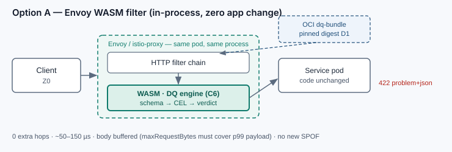

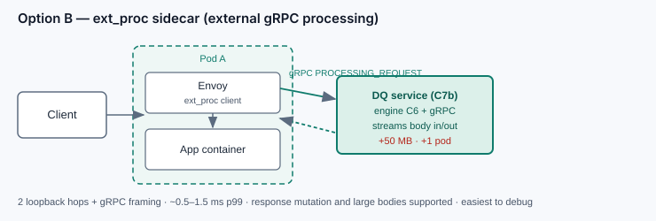

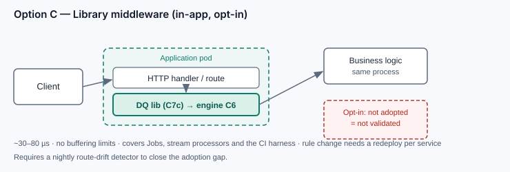

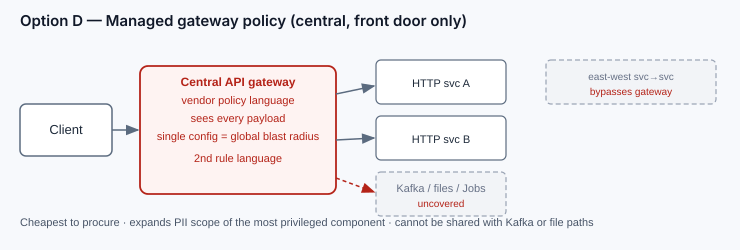

### KD-2 · Semantic rule expression language

| Row | **CEL (chosen)** | **OPA / Rego** | **Custom YAML DSL** |
|---|---|---|---|
| **Description** | Common Expression Language: deterministic, side-effect free, no unbounded loops, cost-limited, RE2 only. Embedded in the engine via `cel-go`. | Declarative policy language evaluated by OPA, typically reached through `ext_authz` or a sidecar. | Bespoke rule schema with a hand-built parser and evaluator. |
| **Pros** | • In-process, no hop, 10–50 µs per rule.<br>• **Impact:** twenty rules cost under 1 ms in total.<br>• Bounded evaluation cost, so tail latency is predictable.<br>• **Impact:** removes the denial-of-service-by-policy class.<br>• Same language as Kubernetes admission CEL.<br>• **Impact:** existing platform skills transfer immediately.<br>• Reference implementations in Go, Java, C++ and Rust. | • Very expressive, with mature tooling, test harness and bundle distribution.<br>• **Impact:** strong for coarse authorisation-style decisions.<br>• Large community and hiring pool. | • Exactly the vocabulary the business asked for, with no translation layer.<br>• **Impact:** stewards can read every rule unaided. |
| **Cons** | • Must be taught to stewards.<br>• **Impact:** mitigated by rule templates plus `dqctl explain`; costs one workshop and a linter.<br>• No cross-record aggregation, so tier-2 needs are handled separately. | • A second control plane to operate and upgrade.<br>• **Impact:** one more platform component in the on-call surface.<br>• Hundreds of microseconds to milliseconds per decision.<br>• **Impact:** per-record Kafka validation becomes expensive. | • Parser, evaluator, cost model and tooling all become yours.<br>• **Impact:** six to nine months of platform work, permanently.<br>• Diverges from the ecosystem and creates a hiring risk. |
| Maintainability (20%) | 4 | 3 | 2 |
| Resilience (20%) | 5 | 4 | 3 |
| Performance (20%) | 5 | 2 | 3 |
| Security (15%) | 5 | 4 | 2 |
| Ecosystem and portability (25%) | 4 | 5 | 1 |
| **Weighted score** | **4.55** | **3.65** | **2.15** |

**Decision.** CEL for semantic rules, JSON Schema 2020-12 for syntax, and no third expression language anywhere in the platform.

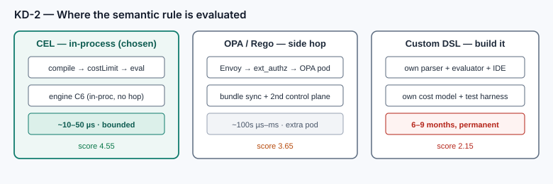

### KD-3 · Rule distribution

| Row | **OCI bundle plus binding CRD (chosen)** | **Rules as CRDs only** | **Central DQ service** |
|---|---|---|---|
| **Description** | Schemas and rules compile into a signed OCI artefact; a small CRD pins digest and mode per workload. | Rule packs are stored as custom resources in etcd. | All validation is delegated to one central API on every medium. |
| **Pros** | • Immutable, signed, cached and replayable.<br>• **Impact:** rollback is a digest revert, and audit is a digest value.<br>• No etcd size limit, so multi-megabyte schemas are viable.<br>• **Impact:** scales to hundreds of objects without architectural change.<br>• Rules ride the existing supply chain with SBOM and provenance. | • Native GitOps, RBAC and audit trail through the API server.<br>• **Impact:** no new artefact type to learn. | • A single component to operate and upgrade.<br>• **Impact:** one place to change for all channels. |
| **Cons** | • Two artefacts to reason about: bundle and binding.<br>• **Impact:** one extra concept in onboarding and in runbooks. | • 1.5 MB object limit and etcd pressure.<br>• **Impact:** large schemas force awkward splitting.<br>• No signing, no SBOM, no provenance.<br>• **Impact:** the rule supply chain is unprotected. | • Single point of failure for every request on every medium.<br>• **Impact:** availability of the whole estate depends on one service.<br>• Adds a per-request network hop to Kafka and file paths.<br>• **Impact:** contradicts the minimal-footprint objective. |
| Maintainability (20%) | 4 | 3 | 2 |
| Resilience (20%) | 5 | 3 | 2 |
| Performance (20%) | 5 | 4 | 2 |
| Security (15%) | 5 | 2 | 3 |
| Ecosystem and portability (25%) | 4 | 3 | 3 |
| **Weighted score** | **4.55** | **3.05** | **2.40** |

**Decision.** OCI bundle for content, CRD for binding. The distribution topology is already shown in [Fig 1](#21-logical-application-view) and [Fig 4](#24-deployment-view), so no separate figure is drawn.

**Sensitivity.** The KD-1 ranking is stable under ±10 percentage points on any single weight. The decisive test is coverage: weight *coverage and time-to-value* at 50% (maintainability 20, resilience 10, performance 10, security 10) and option A scores 3.50 against option C at 3.50 — a tie. That result, not the base-case gap, is why the decision reads **A primary with C retained** rather than A alone: the two mechanisms converge in value as coverage pressure rises, and the retained library is what reaches the writers no proxy observes. KD-2 and KD-3 are not close calls; each holds first place under any weighting that keeps security or ecosystem weight at or above 15%.

---

### Validation model: syntax, semantics and state

Three evaluation tiers, one per kind of question. The tier determines the engine, the cost class, and where the check is allowed to run.

| Tier | Question it answers | Examples | Engine | Cost per message | Runs |
|---|---|---|---|---|---|
| **0 · Syntax** | Is this a well-formed object of this type? | type, required, length, pattern (RE2), enum, range, `format-assertion` dates, precision and scale, character validity, Unicode NFC | JSON Schema 2020-12, compiled once per bundle | 10–50 µs | every ingress, synchronous |
| **1 · Semantic** | Does it mean something valid? | cross-field coherence (`start < end`, sum of lines equals total), conditional requirement, value-set membership, checksum, age or eligibility, mutual exclusion | CEL, cost-limited per rule | 10–50 µs per rule | every ingress, synchronous |
| **2 · Stateful** | Does it agree with the world beyond this message? | uniqueness across a batch, referential existence, legal state transition, temporal plausibility | CEL plus context providers | 100 µs cached to 5 ms remote | only where record context exists |

**Why the split is architectural rather than cosmetic.** Tier 0 is *derived* from the canonical schema and cannot be hand-authored, so it can never disagree with the object definition. Tier 1 is *authored* by the domain and is the only tier where business intent lives. Tier 2 is the only tier whose result is non-deterministic, because it depends on state outside the message — and is therefore the only tier allowed to degrade.

#### Per-channel execution

| Channel | Synchronous | Asynchronous | Why |
|---|---|---|---|
| **HTTP** | tiers 0–1 on request bodies; tiers 0–1 on responses at the system boundary only | tier 2, via outbox or emitted event | request latency dominates; a synchronous tier 2 would add a network hop to every call |
| **Kafka** | tier 0 at the producer interceptor; tiers 1–2 at the stream gate | tier 2 aggregates in a windowed processor | contains poison messages before they reach consumers |
| **File** | tiers 0–2 in the gate job | none required | whole-file context is available in a single pass |

#### Reference data (tier 2)

Tier 2 is where semantic validation most often stalls in delivery, so the provider contract is fixed here rather than left to implementation.

| Provider | Default implementation | If unavailable |
|---|---|---|
| `ValueSet` | shipped inside the bundle, versioned by digest | **bundle fails to boot** — a missing value set is a build defect, not a runtime event |
| `RefDataLookup` | snapshot in the bundle, TTL 15 minutes, refreshed on digest change | circuit breaker opens, dependent rules report `SKIPPED`, alert on breaker state |
| `HistoryLast` | read from the channel's own log or delta | dependent rules report `SKIPPED` |
| `DeltaWindow` | in-memory window in the stream gate or gate job | uniqueness rules report `SKIPPED` |

A rule that declares a provider the binding does not supply makes the bundle unbootable, so the defect surfaces at start-up and in CI rather than at 03:00. `SKIPPED` is always published as a metric and never counted as a pass — this is what the coverage SLI in [§5](#5-availability-resilience-and-nfrs) measures.

### Composition model: layering by intent

`{intent}-{businessObject}` resolves to exactly one effective plan. Nothing beyond the binding lookup is inferred at runtime.

```
L_effective = L_shape(schema)         tier 0 · always · never relaxable
            ⊎ L_object(object@ver)    tiers 1-2 · owned by the object steward
            ⊎ L_intent(intent)        tiers 1-2 · owned by the domain architect
            ⊎ L_channel(channel)      transport constraints
            ⊎ L_binding(environment)  mode and environment overlays
```

**Four normative rules:**

1. **Narrow-only by default.** A later layer may add rules or tighten a constraint; it may not widen one. Widening requires an explicit `relax` block; the compiler rejects it otherwise.
2. **Deterministic order.** `shape → object → intent → channel → binding`; within a layer, severity descending then cost ascending, so the cheapest rejecting check fires first and the most severe violation determines the response.
3. **Severity merges by maximum, never last-write-wins.** Composition can escalate a violation, never de-escalate it.
4. **Conflicts fail the build.** Contradictory predicates on one path — required alongside forbidden, two disjoint enumerations — are a compile error, not a runtime surprise.

```yaml
relax:
  rule: SEM-CUS-002                      # country must resolve in ISO 3166-1
  layer: intent.import                   # the layer attempting to widen
  justification: "legacy migration batch carries pre-1993 country codes"
  approvedBy: [steward.customer, governance.lead]
  expiresAt: 2026-12-31                  # mandatory, forces re-review
```

The compiler rejects a `relax` block that lacks two approvers, omits an expiry, or targets a `CRITICAL` rule. The mandatory expiry converts a permanent exception into a scheduled work item.

**Worked example — same object, two intents, one rule set:**

| Rule | `POST /create-customer` | `POST /amend-customer` | Origin |
|---|---|---|---|
| `SYN-CUS-001` legal name present and printable | applies | applies | object · tier 0 |
| `SEM-CUS-002` country resolves in the value set | applies | applies | object · tier 1 |
| `SEM-CUS-001` verified customer is 18 or older | applies | applies | object · tier 1 |
| `INT-CREATE-001` `customerId` must be absent | applies | — | intent · create |
| `INT-CREATE-002` consent flag matches requested marketing | applies | — | intent · create |
| `INT-AMEND-001` `customerId` must be present | — | applies | intent · amend |
| `INT-AMEND-002` amendment reason at least 10 characters | — | applies | intent · amend |
| `CH-KAFKA-001` no reliance on HTTP headers | applies | applies | channel · kafka |

The property that matters is what is *not* possible: `intent.amend` cannot disable `SEM-CUS-001`. An intent adds obligations to a shared invariant and never subtracts them — which is precisely what makes central rule ownership credible to the steward who signed up to that invariant.

### Violation contract: one object, three renderings

| Field | Example | Purpose |
|---|---|---|
| `ruleId` | `SEM-CUS-001` | joins to the rule registry and to the Git commit |
| `severity` | `CRITICAL` | drives channel behaviour (reject, DLQ, annotate) |
| `path` | `$.dateOfBirth` | machine-actionable location in the object |
| `dimension` | `accuracy` | rolls up into the quality scorecard |
| `intent`, `object`, `objectVersion` | `create`, `customer`, `1.4.0` | makes the decision reproducible |
| `packDigest` | `sha256:9f2c…` | proves which rules ran |
| `correlationId` | `01J8Z…` | joins HTTP, Kafka and file evidence for one record |
| `message` | "Verified customers must be 18 or older" | human-readable, template-driven, never interpolated with sensitive values |

| Channel | Rendering | Semantics |
|---|---|---|
| **HTTP** | `422 application/problem+json` per RFC 9457: `type`, `title`, `detail`, `instance`, plus `violations[]` and `correlationId`; response header `DQ-Pack-Digest` | one problem per request, carrying every violation found |
| **Kafka** | record routed to `.dlq` with headers `dq.violation.count`, `dq.violations` (base64 JSON, capped at 8 KB), `dq.pack-digest` | `MINOR` annotates (`dq.warn=1`) and forwards |
| **File** | `rejects.csv` with columns `row, ruleId, severity, path, message`, plus `manifest.json` counts and digest | accepted records are written only when the gate passes |

**Redaction.** Violation payloads never echo field values. A field marked `x-dq-sensitive: true` is reported by path only, and message templates are declarative — the compiler rejects any template that interpolates a sensitive field. Reject files inherit the classification of the object they contain, are encrypted at rest, and carry the binding's retention period rather than the pipeline's default.

---

## 4. Value, impact and investment

**Answer: twelve adoption costs across five groups, three of them organisational — set against four benefit drivers whose value depends on a baseline the first week of work must produce.**

### 4.1 Adoption costs

| # | Consequence | Where impacted | Who impacted | Rating | Mitigation |
|---|---|---|---|---|---|
| I1 | A business-object change now requires a registry pull request before any API change can ship | CI pipeline, API release process | Application teams, domain stewards | High (process) | PR template generated by `dqctl scaffold`; object changes batched weekly |
| I2 | Authority over validation moves from application teams to domain stewards | `catalog/` and `rules/` CODEOWNERS | Stewards, application teams | High (organisation) | Explicit RACI; application teams retain adapter and binding ownership |
| I3 | HTTP clients receive new `422` responses in `problem+json` form | API contract, client SDKs, consumer applications | Consumer teams, third-party integrators | High (external) | 90-day notice, WARN mode first, published SDK error mapping |
| I4 | 50–150 µs added per request on the WASM path, 0.5–1.5 ms on the ext_proc path | Ingress latency budget, capacity planning | SRE, performance owners | Medium | Budget agreed in M0 and measured at p99 before enforcement |
| **I5** | Kafka gains `.validated` and `.dlq` topics plus a consumer group | Topic topology, consumer offsets, on-call | Data platform, producer teams | High (operations) | Replay tooling and runbook delivered with the Kafka wave |
| I6 | Batch pipelines gain a gate step and emit rejects | Argo workflows, batch service levels | Batch operations | Medium | Gate job idempotent and resumable; service-level buffer per pipeline |
| I7 | A rule change can reject live traffic | Runtime, customer experience | Whole business | High (business) | Mandatory shadow-then-warn-then-enforce ladder; one-line kill switch |
| I8 | Pod start-up now depends on the OCI registry | Pod start, node scale-up | Platform, SRE | Medium | Bundle cached in emptyDir, baked fallback bundle, stale-bundle alert |
| I9 | CI duration grows by two to four minutes per API pull request | Pull-request feedback loop | Application teams | Low | Cache the schema intermediate representation; align only changed paths |
| I10 | The governance catalogue gains automated assertions per object | DataHub or OpenMetadata | Data governance, analytics | Low (positive) | Read-only projection; the catalogue never becomes a second source |
| I11 | A new on-call surface appears for the gate job and the stream gate | Alerting, runbooks | Data platform | Medium | Fold into the existing pipeline rota rather than creating a new one |
| I12 | Security review is required for a new executable in the request path | Penetration testing, threat model | Security | Medium | WASM sandbox with no syscalls or network; distroless images; cosign verification |

**Impact on the delivery sequence.** I1, I2 and I7 are organisational rather than technical and are the slowest to absorb: they must start in the first wave, in parallel with the build work, or they will gate enforcement later.

### 4.2 Value at stake

Four drivers. Each is a **definition with a confidence rating, not a number**, until the week-one baseline establishes the inputs — the discipline that keeps this section defensible in front of a challenged number.

| Driver | Mechanism | Confidence | Input required |
|---|---|---|---|
| **D1** Avoided downstream rework | Defects rejected at ingest rather than discovered in reconciliation | Medium | Escaped defects per year × cost per defect × share catchable at the boundary |
| **D2** Retired validation implementations | Two of three implementations decommissioned per object | **High** | Engineering days per year currently spent maintaining them |
| **D3** Reduced incident effort | Rule change in ≤ 1 day instead of weeks | Medium | Incidents per year × reduction in mean time to repair |
| **D4** Avoided regulatory findings | Dated, provable rule history per record | Low–Medium | Treated as avoided cost; **excluded from payback** |

D4 is deliberately excluded from the payback calculation. Claiming regulatory avoidance as a benefit invites a challenge the programme cannot win, and the case does not need it.

### 4.3 Investment and payback

| Item | One-off | Recurring |
|---|---|---|
| Build, Waves M0–M7 | 10 engineer-weeks | — |
| Run: CI minutes and OCI storage | — | Below 1% of existing platform CI |
| Run: Envoy capacity | — | Inside existing headroom (50–150 µs per request) |
| Licences | Zero | Zero — every component is open source or already owned |
| **Total** | **10 engineer-weeks** | **Immaterial** |

**Payback rule.** One-off build ÷ annualised (D1 + D2 + D3). The case is deliberately built to stand on **D2 alone**: if retiring two validation implementations per object recovers the build cost within twelve months, the programme is justified on cost avoidance and every quality improvement is upside. That is the test the first week of work must run.

**Basis of estimates.** Latency (50–150 µs), service levels (99.95%) and throughput figures in this document are engineering estimates pending the M0 benchmark. They are disclosed once here rather than qualified at every occurrence; where a figure changes, §5 and the NFR register are the single places to change it.

---

## 5. Availability, resilience and NFRs

**Answer: the guardrail adds no runtime dependency, so it cannot become the availability bottleneck it exists to prevent — provided coverage is measured separately from uptime, which most programmes forget until a filter has been failing open for a month.**

**Design premise.** The primary HTTP mechanism adds **no runtime dependency**: the engine is in-process, in memory, deterministic, and reads only a pre-loaded bundle. There is therefore **no new single point of failure in the request path**, which is the decisive availability argument for KD-1 option A over options B and D.

### 5.1 Service level indicators

| Service level indicator | Target | Measurement |
|---|---|---|
| Validation availability | ≥ 99.95%, inheriting from Envoy | Error ratio on the validation path |
| Added p99 latency, HTTP | ≤ 1 ms | `dq.duration{adapter=wasm}` |
| Added p99 latency, per Kafka record | ≤ 150 µs | `dq.duration{adapter=kafka}` |
| Bundle rollout to 95% of pods | ≤ 5 min | `dq.pack.digest` gauge skew |
| False-positive rate | ≤ 0.01% of requests | Shadow report versus sampled manual review |
| Rule-drift escapes | Zero per quarter | Post-incident review and alignment audit |
| **Evaluation coverage** | ≥ 99.9% of eligible requests actually evaluated | `dq.rules.evaluated ÷ data-plane requests`; page below 99.5% |
| Rules skipped by cost limit or provider outage | ≤ 0.1% of evaluations | `dq.rule.skipped{reason}` |

**Coverage is measured separately from availability, deliberately.** A fail-open engine fault, an exhausted cost limit or a tripped provider breaker all serve traffic successfully while validating nothing — the one failure mode an availability SLI is blind to by construction. Coverage is therefore the SLI that answers "is the guardrail actually guarding?", and it is reported per channel, per object and per binding rather than as a single estate-wide number.

### 5.2 Failure modes and recovery

| Failure mode | Behaviour | Detection | Recovery |
|---|---|---|---|
| OCI registry unavailable at pod start | Start using the cached or baked bundle | `dq.bundle.source=baked` | Registry is replicated; no operator action |
| OCI registry unavailable at runtime | No impact, because the bundle is resident | Not applicable | Not applicable |
| Engine fault inside the WASM filter | Request handled per binding policy; fail-open is default in SHADOW and WARN | Envoy statistics and `dq.engine.panic` counter | Filter reload, then automatic revert to the previous digest |
| Rule exceeds the evaluation cost limit | Rule reported as skipped, violation event emitted | `dq.rule.skipped` | Rule rewritten; per-rule cost limit raised |
| Context provider slow or unreachable | Circuit breaker opens, tier-2 rules degrade to skipped | Provider latency histogram | Cached snapshot serves traffic; alert on breaker state |
| Digest mismatch across pods | Traffic is still served; skew is flagged | `dq.pack.digest` gauge with alert | Argo resynchronisation; no data rollback needed |
| Kafka gate unavailable | Consumers lag; producers remain unblocked by producer-side syntax checks | Consumer-group lag | Scale the gate; replay from the source topic |
| File gate job crashes mid-file | Job retried; partial output discarded because acceptance is marked atomically | Argo retry and job status | Re-run; downstream never observes partial data |
| A bad rule causes mass rejection | Quality circuit breaker trips and reverts the binding to SHADOW | Violation rate versus baseline | One-line pull request, or automatic when the threshold is breached |
| Node or zone loss | Envoy-per-pod design and Job rescheduling already cover it | Standard Kubernetes signals | No DQ-specific action |

**Reconciling the baked fallback with digest pinning.** The baked bundle is not an exception to "digests, never tags": it carries its own digest, which the binding declares as `fallbackDigest`. The runtime reports both `dq.bundle.digest` and `dq.bundle.source{primary|fallback}`, so a pod serving from the fallback is visible and alertable, and S6 still holds because the digest reported in the violation payload is the one that actually ran. A `fallbackDigest` more than one minor version behind `bundle` raises a governance finding during the nightly reconciliation — an over-stale fallback is a silent policy rollback, which is the failure this control exists to prevent.

**Blast-radius containment.** Binding scope is a namespace, a workload, or a path prefix. SHADOW is the default on first deployment. `mode: OFF` is a one-line revert. Every decision is stamped with `DQ-Pack-Digest`, so divergence between enforcement points is observable within a single scrape interval.

**Degrade ladder.** `ENFORCE → WARN (log only) → SHADOW (observe only) → OFF`. Each step is configuration-only and is supported by every adapter, so an incident never requires a code change.

**Determinism as a resilience property.** Schema matching and CEL evaluation are pure functions of message plus bundle: no clocks beyond an injected `now`, no I/O beyond declared providers. Retries are therefore safe, results are reproducible for replay, and the same record validated on HTTP and later on Kafka must produce identical violations — which is exactly what the shared digest guarantees.

### 5.3 NFR register and design response

Every non-functional requirement in one place, with the design element that satisfies it and the wave that proves it. This is the traceability a reviewer needs in order to challenge a claim rather than accept it.

| NFR | Target | Design response | Proven by |
|---|---|---|---|
| Added latency, HTTP | ≤ 1 ms p99 | In-process WASM, no network hop (C7a) | M0 benchmark, then continuous |
| Added latency, Kafka | ≤ 150 µs per record | Tiers 0–1 only at the gate; tier 2 windowed (C8) | M2 benchmark |
| Throughput, file | 10k records/s per job instance | Streaming reader, constant memory (C9) | M5 test at p95 file size |
| Availability | ≥ 99.95% | No new runtime dependency (§5 premise) | SLO dashboard |
| Evaluation coverage | ≥ 99.9% of eligible requests | `SKIPPED` published as a metric, never counted as a pass | Coverage SLI |
| Data loss on gate failure | Zero records accepted unverified | Atomic acceptance marker: no `_SUCCESS`, no downstream start | M5 crash test |
| Security: payload exposure | No payload egress beyond the owning pod | Per-service placement (§2.3) | Penetration test, M7 |
| Security: rule integrity | No unsigned bundle executes | cosign verification and digest pinning (C5 → C6) | Admission policy test, M7 |
| Maintainability | One engine, one rule language | C6 is the sole owner of semantics | Code review gate |
| Operability | Revert enforcement without a deployment | Binding `mode` field | Game day, M7 |
| Portability | Any Envoy-lineage proxy | WASM, no vendor API | M3 staging |
| Cost | No new licences; under 1% CI increase | Open-source components only | Finance review at G2 |

Targets remain the estimates disclosed in [§4.3](#43-investment-and-payback) until M0 replaces them with measurements.

---

## 6. System dynamics

**Answer: the same record produces identical verdicts on HTTP, Kafka and file, because every adapter hands one engine the same envelope and the same digest.**

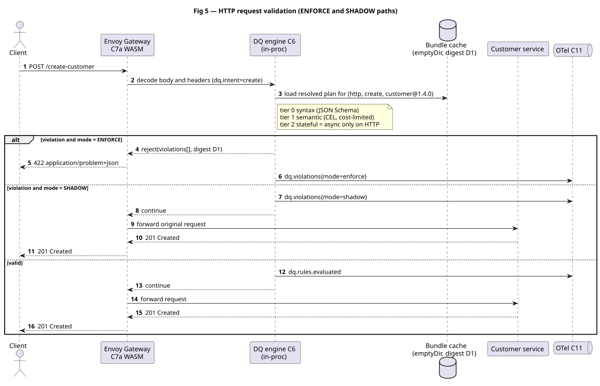

Fig 5 shows the two operational branches that matter: the ENFORCE branch terminates the request with a violation payload, while the SHADOW branch forwards the original request unchanged and emits only telemetry.

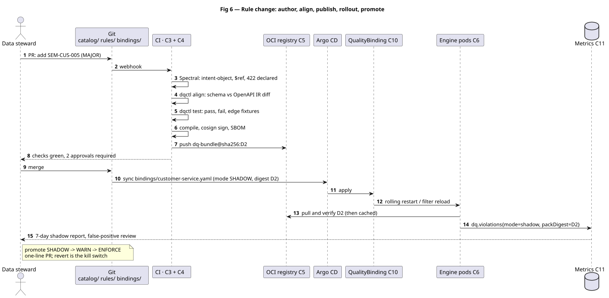

Fig 6 is the governance path. Note that promotion between modes is a binding change, not a redeployment, and that the shadow report is the evidence used to authorise it.

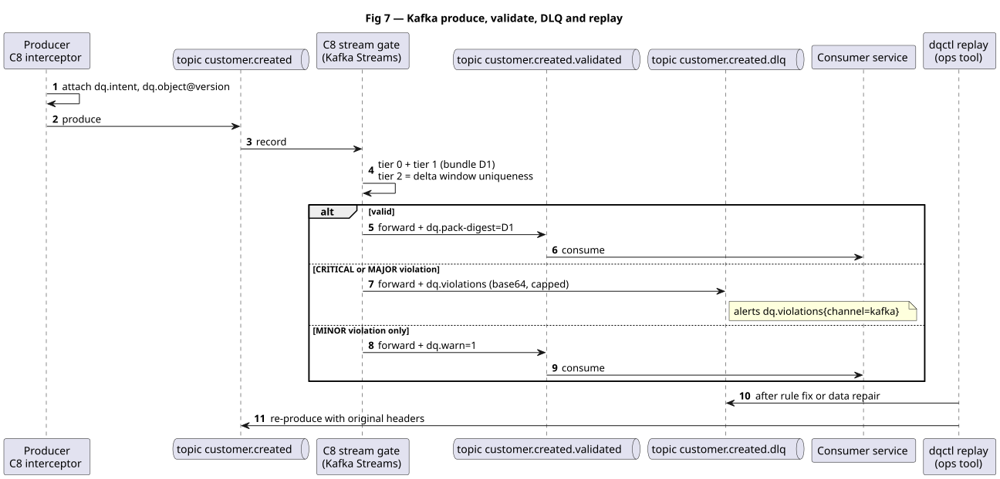

Fig 7 uses header-based addressing, so the gate needs no schema registry lookup and no topic-to-object mapping table. Replay reuses original headers, which keeps the record self-describing after repair.

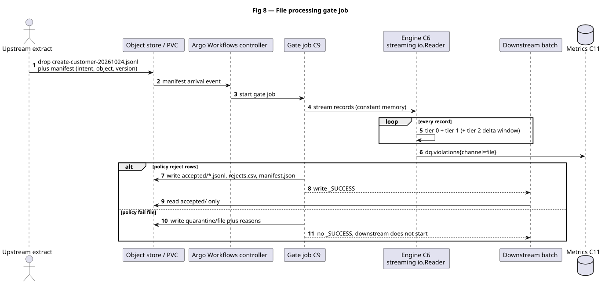

Fig 8 makes acceptance atomic: downstream jobs trigger on the acceptance marker, never on the raw drop, so a partially validated file can never be consumed.

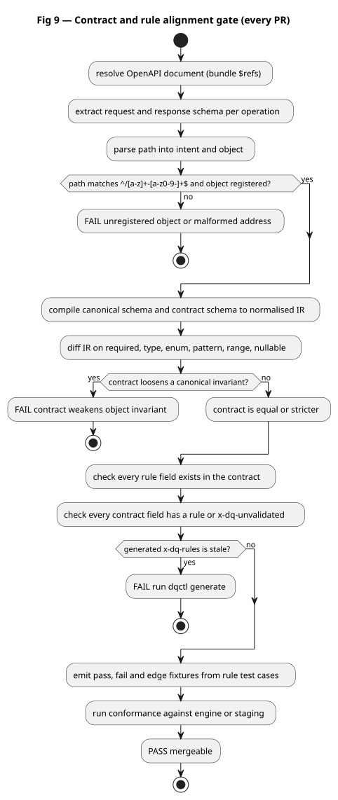

Fig 9 is the enforcement mechanism for the governing invariant. It runs on every pull request, and its failure modes are the five alignment layers described in [section 7](#7-single-source-of-truth-and-governance).

---

## 7. Single source of truth and governance

**Answer: one artefact graph, seven invariants and one accountable owner per metric turn drift from a discovery into a build failure.**

The source of truth is a **directed artefact graph rooted in Git**, governed by seven invariants. Anything outside the graph is a projection and is never edited by hand.

```
catalog/business-objects/*.json ─────┐
catalog/value-sets/*.yaml ───────────┼─→ dqctl compile ─→ dq-bundle@digest ─→ C6 runtime
rules/object/*.pack.yaml ────────────┤                          │
rules/intent/*.pack.yaml ────────────┘                          ├─→ DQ-Pack-Digest on the wire
spec/openapi/*.yaml ──── $ref ───────┘                          └─→ violations (ruleId + digest)
```

### 7.1 Invariants

| # | Invariant | Enforcement |
|---|---|---|
| S1 | Exactly one canonical schema per object and major version. Contracts must `$ref` it; inline copies are forbidden. | Spectral rule plus intermediate-representation diff |
| S2 | Value sets and enumerations exist only in `catalog/value-sets`; rules reference them by identifier. | `dqctl lint` rejects literal enumerations inside rules |
| S3 | Rules are code: reviewed, versioned, immutable once published. A rule is **retired**, never deleted, so historical violations remain interpretable. | Pack schema plus CODEOWNERS |
| S4 | The runtime never invents rules; it evaluates a resolved plan from a signed digest. | Engine refuses unsigned bundles |
| S5 | Generated artefacts (`x-dq-rules`, fixtures, catalogue export) are never hand-edited. | `dqctl generate --check` in CI |
| S6 | Every runtime decision is traceable to a Git commit through `ruleId` and `packDigest`. | Digest on the wire and in the violation payload |
| S7 | **Publication and adoption are separate events.** Publishing a bundle changes no runtime behaviour; enforcement changes only when a binding adopts a digest. | Bindings pin digests; `dq.pack.digest` and `dq.bundle.source` reported per workload |

### 7.2 Alignment layers

The requirement that object validation rules and OpenAPI contracts must agree is met by five layers, cheapest first.

| Layer | Mechanism | Catches |
|---|---|---|
| **L1 Structure** | The contract `$ref`s the canonical schema identifier instead of restating properties | Duplicated definitions drifting apart |
| **L2 Lint** | Spectral: path shape, `x-dq-intent` equals the path segment, object registered, `422` declared, no inline object schemas | Naming drift, missing error contract |
| **L3 Equivalence** | Both schema sources compile to one normalised constraint representation, then diff on required, type, enum, pattern, range, nullable | A contract that is *looser* than the canonical object |
| **L4 Coverage** | Every rule field must exist in the contract; every contract field needs a rule or an explicit `x-dq-unvalidated` justification | Unowned fields, orphan rules |
| **L5 Conformance** | Compiler emits pass, fail and edge fixtures from rule test cases; CI replays them against the engine or staging | A service that claims enforcement but does not perform it |

**Honest limitation.** Full subsumption for JSON Schema 2020-12 is not decidable in general. L3 therefore compares a deliberately bounded constraint vocabulary, and a lint rule forbids keywords outside that vocabulary. This is a design choice: it keeps alignment machine-checkable and explainable, at the cost of excluding exotic schema constructs from canonical objects.

### 7.3 Ownership

| Path | Owner | Required approval |
|---|---|---|
| `catalog/business-objects/**` | Domain steward | One steward and one architect |
| `catalog/value-sets/**` | Reference-data owner | One owner |
| `rules/object/**`, `rules/intent/**` | Domain architect | One steward |
| `bindings/**` | Platform | One platform engineer |
| `tools/dqctl/**`, `engine/**` | Platform | Two platform engineers |
| Any `relax:` block | — | Steward and governance lead; the build fails without both |

### 7.4 Versioning and immutability

Objects and packs follow semantic versioning and are **additive-only within a major**. The runtime addresses `object@major.minor.patch`; a major bump is a new schema identifier and a parallel pack, never an in-place edit. Bindings pin **digests, never tags**, so the question "which rules evaluated this record" remains answerable years later.

### 7.5 Deliberate non-duplication

OpenAPI extensions, catalogue entries in DataHub or OpenMetadata, dashboards and fixtures are all **generated projections**. The catalogue is explicitly read-only with respect to rules: no bidirectional synchronisation, because a second editable copy is the most common way a single source of truth dies.

### 7.6 Quality model

Every rule carries a `dimension`, so scorecards are computed from the violations the engine already produces rather than from a separate measurement process. Six dimensions: the five conventional ones plus **validity**, which is called out separately because syntax is the tier this architecture enforces most cheaply and it would otherwise be hidden inside accuracy.

| Dimension | Computed as | Tiers | Default threshold |
|---|---|---|---|
| **Completeness** | records with all required fields present ÷ records | 0 | ≥ 99.5% |
| **Validity** | records passing the full tier-0 plan ÷ records | 0 | ≥ 99.9% |
| **Accuracy** | records passing tier-1 rules, weighted by severity | 1 | ≥ 99% |
| **Consistency** | records passing cross-record and cross-channel rules | 1, 2 | ≥ 99.5% |
| **Uniqueness** | 1 − duplicate rate within the declared key, per window | 2 | 100% |
| **Timeliness** | records with `eventTime` inside the binding's freshness window | 1 | ≥ 98% within 15 min |

Thresholds are defaults; each object's steward ratifies its own in `customer.meta.yaml`, because a migration object and a payments object do not deserve the same tolerance. Scores are published per object, per dimension and per channel.

**Accountability.** A dimension below threshold for two consecutive periods raises a governance finding against the **object steward**, not the platform team. The platform owns the mechanism and its availability; the steward owns the number. This split is what stops the quality model degrading into a platform dashboard nobody is accountable for.

### 7.7 Operating model and decision rights

Ownership is only real when it is matched to decision rights and to a forum that asks for the evidence. Seven activities, six roles.

| Activity | Object steward | Domain architect | Platform | App team | Security | Governance lead |
|---|---|---|---|---|---|---|
| Object schema change | **A** | R | C | I | C | I |
| Rule pack change | C | **A** / R | C | I | I | I |
| Relax or exception | C | R | C | I | I | **A** |
| Binding and mode change | I | C | **A** / R | C | I | I |
| Bundle publication | I | C | **A** / R | I | C | I |
| Enforcement promotion | **A** | C | R | I | I | C |
| Adapter choice per service | I | C | **A** | R | I | I |
| Scorecard review and threshold change | **A** | R | C | I | I | C |

R responsible, A accountable, C consulted, I informed. Exactly one A per row, by construction — an activity with two accountable owners has none.

**Forums and cadence.**

| Forum | Cadence | Purpose | Chair | Output |
|---|---|---|---|---|
| **DQ Council** | Monthly | Scorecard review, threshold ratification, wave promotion | Governance lead | Governance findings raised against stewards |
| **Design Authority** | At each gate G1–G3 | Gate decision on evidence | Domain architect | Go or hold |
| **Platform Ops** | Weekly | Service levels, coverage SLI, bundle rollout, incidents | Platform lead | Remediation actions |

**Escalation is deliberately split three ways.** A coverage-SLI breach is a platform incident. A dimension breach is a steward governance finding. A rule conflict at compile time is an architect decision. Keeping the paths separate is what prevents "the data is bad" from defaulting to the platform team for want of anywhere else to land.

### 7.8 Lifecycle: publish, adopt, retire

Digest pinning has a consequence that is easy to miss and expensive to discover late: **content publication and workload adoption are two separate events.** Merging a rule change makes a new bundle available; it changes production behaviour only when a binding moves to that digest.

```
  merge ──► CI compile ──► PUBLISH ────► OCI registry (digest D2 exists; live nowhere)
                              │
                              └──► ADOPT (per workload) ──► binding: bundle: sha256:D2
                                                             │
                                                             └──► pods and gates reload and stamp D2
```

| | **Publish** | **Adopt** |
|---|---|---|
| Trigger | Any merge to main | A change to one binding |
| Frequency | Every change | Deliberate, per workload |
| Blast radius | None | One workload |
| Rollback | Not applicable | Revert one line |
| Answers | "What content exists?" | "What is live where?" |
| Clock | Build — about 3 minutes | Propagation — under 5 minutes |

Three operational consequences follow, and all three are frequently rediscovered the hard way. A rule change is **not** a release. **Staged adoption is native** — one service adopts first as a canary while the rest stay on the previous digest, which is where the SHADOW ladder actually takes effect. And "I fixed the rule and production has not changed" is the *expected* state of the system, not a defect: nobody has adopted it yet.

**Artefact states.** Every object contract, rule pack and binding moves through the same six states. The names are normative here; the transitions, the evidence required and the actor who performs each are specified in the [Operating Model](control-plane-operating-model.md#3-lifecycle-states-and-transitions).

| State | Meaning | Leaves the state when |
|---|---|---|
| `draft` | Being authored; not yet reviewable | A pull request is opened |
| `proposed` | Under review with all CI gates green | The required approvers approve |
| `published` | Immutable inside a signed bundle; live nowhere | A binding adopts its digest |
| `adopted` | Live for at least one workload | A newer digest supersedes it |
| `superseded` | Replaced but still interpretable | Its retention period expires |
| `retired` | Never evaluated again, retained as evidence | Never — records cite it forever (S3) |

**What this section does not cover.** Per-channel propagation mechanics, change classes and their ceremony, per-rule suppression, inventory and impact queries, reference-data cadence and the break-glass path are procedures, not constraints, and live in the [Control Plane Operating Model](control-plane-operating-model.md). This section states only the constraint that makes those procedures necessary.

---

## 8. Risks, assumptions and what would have to be true

**Answer: three assumptions carry the recommendation; if the first fails, the design survives but the benefit case does not.**

**What would have to be true.** The recommendation holds if, and only if, three things are true. Stating them as conditions rather than caveats is what makes the decision testable.

- **Most write traffic crosses Envoy lineage (A1).** If it does not, zero-touch coverage is unattainable and the library becomes the primary mechanism: the design survives, at roughly half the coverage and without the onboarding economics that justify the build.
- **A platform team owns the filter and the CI gate (A2).** Distributing ownership across forty application teams reproduces the drift this programme exists to remove.
- **Semantic rules need only bounded reference data at request time (A3).** If they need live lookups on the critical path, tier 2 moves out of the request path and the latency budget must be revisited.

If all three hold, the programme reaches 80% coverage at the cost and service levels stated. If A1 fails, the case for funding shifts from benefit realisation to defect containment — a materially weaker argument that should be made openly at gate G2 rather than discovered there.

### 8.1 Assumptions and open items

| # | Assumption | If false |
|---|---|---|
| A1 | Envoy lineage or a service mesh fronts the majority of write traffic | Fall back to KD-1 option C plus a route-drift detector |
| A2 | A platform team can own the WASM filter and its upgrades | Sequencing shifts to library-first, which is slower to reach full coverage |
| A3 | Semantic rules need only the message plus cached reference snapshots at request time | Add live context providers; the latency budget must be revisited |
| A4 | Business objects are JSON-serialisable at the system boundary | gRPC paths require the library adapter or a normalising proxy |
| O1 | How many business objects are in wave one (recommend one to three) | A wider first wave delays the first enforcement by several weeks |
| O2 | Payload p99 size, which drives `maxRequestBytes` and buffer risk | If above 1 MB, that service uses the `ext_proc` adapter (KD-1 option B) |
| O3 | File formats and typical sizes (JSONL and CSV first, Parquet later) | Parquet adds a reader dependency and memory profiling |
| O4 | Whether a schema registry already exists | If so, it becomes a read-only mirror of `catalog/`, never a peer |

### 8.2 Risk register

One register, one owner per risk, and an explicit trigger — a risk without a trigger is a sentiment.

| # | Risk | Likelihood | Impact | Owner | Mitigation | Trigger to act |
|---|---|---|---|---|---|---|
| R1 | Envoy lineage absent from most write paths (A1 fails) | Medium | High | Platform lead | Library-first fallback; nightly route-drift detector | M0 landscape finding |
| R2 | False positives erode trust in the first week | High | High | Domain architect | Mandatory SHADOW; sampled false-positive review; quality circuit breaker | Rate above 0.01% |
| R3 | Stewards unavailable or unengaged | Medium | High | Governance lead | Named stewards before G1; two hours per week commitment agreed | G1 not passed |
| R4 | Alignment gate blocks releases | Medium | Medium | Platform lead | `x-dq-unvalidated` escape hatch; align only changed paths | More than two CI failures per week |
| R5 | Tier-2 reference data unavailable or slow | Medium | Medium | Data platform | Bundle snapshots by default; circuit breaker; `SKIPPED` visible | Provider p99 above 50 ms |
| R6 | Body limits bypass large payloads | Medium | Medium | Platform lead | p99 payload measured in M0; `ext_proc` fallback | Payload p99 above 1 MB |
| R7 | Rule proliferation makes bundles unmaintainable | High | Medium | Domain architect | Pack size budget; retire-never-delete lifecycle | More than 40 rules per object |
| R8 | Single-engineer dependency on the filter | Medium | High | Platform lead | Two-person ownership; ADRs; pairing on M3 | Bus factor of one |
| R9 | Personal data leaks through violations or reject files | Low | High | Security | Redaction compiler rule; encrypted rejects with retention | Any suspected leak |
| R10 | Registry outage during node scale-up | Low | Medium | SRE | Replicated registry; declared `fallbackDigest` | Pod start-up failures |
| R11 | Programme outlives sponsor attention | Medium | High | Executive sponsor | Value released per wave; three gates with named owners | Two consecutive gates missed |
| R12 | Scope creep into remediation and cleansing | High | Medium | Governance lead | Scope statement excludes remediation; refer to owning team | Any remediation request |

R2 and R12 are the two that most often kill programmes of this shape: R2 in week one, when the first false positive reaches a customer, and R12 in month six, when remediation looks like the easier win than prevention.

---

## 9. Transition roadmap

**Answer: alignment is funded first — it fixes a problem the business already feels, needs no runtime change, and de-risks every later wave.**

Sequenced so that each work package produces something independently useful, and nothing is funded that only pays off at the end. Effort is engineer-weeks for a small platform team of two, plus part-time domain stewardship.

### 9.1 Work packages and exit criteria

| Wave | Scope | Exit criteria | Depends on | Effort (eng-weeks) |
|---|---|---|---|---|
| **M0 · Decisions and measurement** | Ratify this document; benchmark WASM against `ext_proc` and middleware at 1 KB and 100 KB payloads; baseline current defect economics and payload p99 size (O2) | Decision record signed; measured overhead agrees with the §5 SLOs or the SLOs are revised; baseline recorded | — | 1.0 |
| **M1 · Alignment gate** | Canonical schema for wave-1 objects; object and intent packs; `dqctl align` plus the Spectral rules; RFC 9457 component; bundle compile and signing in CI | A pull request that loosens a required field or invents a field fails CI; `x-dq-rules` is generated and drift-checked; first signed bundle published | M0 | 1.5 |
| **M2 · Engine and library** | Tiers 0–1 in Go; HTTP middleware; `dqctl test`; shadow mode; OTel metrics including the coverage SLI | Shadow report on one real service with a sampled false-positive review; p99 overhead measured against the M0 budget | M1 | 1.5 |
| **M3 · HTTP zero-touch** | WASM filter or `ext_proc` per the M0 landscape finding; `QualityBinding` CRD with CEL validation; Helm values | A service with no code change is enforced in staging; reverting the binding demonstrably stops enforcement within five minutes | M2 | 1.5 |
| **M4 · Kafka** | Header envelope; producer interceptor; stream gate; `.dlq` and replay tooling | Three existing topics gated in shadow, then syntax-only enforcement; replay of a DLQ record restores it to the topic | M2 | 1.0 |
| **M5 · File** | Streaming reader for JSONL and CSV; gate job; `accepted/`, `rejects.csv`, `manifest.json`; Argo step | A file at or above the 95th percentile size is gated in one pass with constant memory; rejects are explainable per row | M2 | 1.0 |
| **M6 · Tier 2 and governance** | Context providers; stateful rules; quality scorecards; DataHub or OpenMetadata export; promotion automation; quality circuit breaker | Uniqueness and referential rules enforced on at least one channel; scorecard published per dimension; one shadow-to-enforce promotion executed by automation | M3, M4, M5 | 1.5 |
| **M7 · Hardening** | cosign verification in the deploy path; SBOM and provenance; redaction audit; cost-limit and regex chaos tests; contract-conformance suite; runbooks | Production readiness review passed; kill switch and degrade ladder exercised in a game day | M6 | 1.0 |

### 9.2 Indicative calendar and value release

Two engineers from week 1, no dependency on platform procurement. M4 and M5 overlap by design; if only one engineer is available, sequence them and add two weeks.

| Wave | Weeks | Cumulative effort | Value released on completion |
|---|---|---|---|
| M0 | 1 | 1.0 | Measured baseline and a defensible business case |
| M1 | 2–3 | 2.5 | Contract drift becomes a CI failure — first visible benefit, zero runtime change |
| M2 | 4–6 | 4.0 | Shadow enforcement on one service; the false-positive rate is known |
| M3 | 7–9 | 5.5 | Zero-touch enforcement on one service; onboarding becomes a pull request |
| M4 | 8–10 | 6.5 | Kafka poison-message containment with replay |
| M5 | 8–10 | 7.5 | File gate; rejects explainable per row |
| M6 | 11–13 | 9.0 | Tier-2 rules and published scorecards |
| M7 | 14–15 | 10.0 | Production readiness; kill switch exercised |

Note that M1 delivers the first benefit in **week 3 at 2.5 engineer-weeks** — before any runtime component exists. That is the sequencing argument in one line, and it is the reason the first funding tranche is defensible on its own.

### 9.3 Decision gates

Three gates, each with one accountable owner:

| Gate | Question | Owner | Consequence if not passed |
|---|---|---|---|
| **G1** (end M1) | Are the artefacts and the alignment gate credible? | Domain architect | Stop — the runtime is worthless without a trustworthy definition |
| **G2** (end M3) | Is zero-touch HTTP enforcement operationally safe? | Platform lead | Hold at M2 (library only) and accept reduced coverage |
| **G3** (end M6) | Is the quality model producing decisions, not just metrics? | Data governance lead | Enforce syntax and semantics only; defer tier 2 |

**Coverage KPI.** Enrolled write paths ÷ total write paths, reported monthly. Target 10% by the end of M3, 40% by M5, 80% by M7. Coverage — not rule count — is the programme's health metric, because an unenrolled path is an invisible defect rather than a deferred one.

**Why this order.** M1 is funded first because alignment alone fixes the problem the organisation can already feel — contract drift — and requires no runtime change at all. M2 precedes M3 because the library is the harness the WASM filter is validated against. M4 and M5 are independent and run in parallel if staffing allows.

---

## Appendix A — regenerating the figures

Diagrams are code, so they are reviewed as text and rendered in CI. Sources live in `puml/` and rendered output in `figures/`.

```bash
# requires: java 17+ and plantuml.jar on the classpath or at /tmp/plantuml.jar
java -jar plantuml.jar -tsvg -failfast2 -charset UTF-8 \
  -o ../figures docs/architecture/puml/*.puml
```

The KD-1 and KD-2 schematics in `figures/kd*.svg` are hand-authored SVG and are edited directly; they are validated with `xmllint --noout`.

## Appendix B — related artefacts

| Artefact | Purpose | Status |
|---|---|---|
| [`ci/spectral.yaml`](../../ci/spectral.yaml) | L2 alignment lint rules | Working; rules marked `[M1]` await custom functions |
| [`ci/dqctl-align.yml`](../../ci/dqctl-align.yml) | CI pipeline for align, test, bundle, publish, sign and attest | Working (16 steps); registry push and signing deferred |
| `catalog/`, `rules/`, `bindings/` | Source-of-truth tree described in §7 | Present under `examples/party-model/`; promotion to the repository root is a pending decision |
| `engine/`, `tools/dqctl/` | Runtime and compiler | Working: `validate`, `lint`, `align`, `test`, `generate`, `bundle`, `publish` (layout only) |
| `catalog/schemas/` | Versioned schemas for the artefacts in Appendix C | 11 formats, v1.2.0 |
| [`control-plane-operating-model.md`](control-plane-operating-model.md) | How objects and rules are managed and disseminated: lifecycle, propagation, suppression, queries, break-glass | v0.1, living |
| [`delivery-design-pack.md`](delivery-design-pack.md) | Build contracts: artefact schemas, `dqctl` contract, environments and promotion, precedence, test strategy | v0.1, living |
| [`data-plane-operations-guide.md`](data-plane-operations-guide.md) | Metric and alert catalogue, runbooks F-01–F-12, retention, support model, capacity model, cutover stages | v0.1, living |
| [`../steward-guide.md`](../steward-guide.md) | One-page authoring workflow for domain stewards | v0.1, living |

---

## Appendix C — artefact schemas

Four artefact types and one bundle, abbreviated to the shape a reviewer needs. The examples are **illustrative here and normative in the [Delivery Design Pack](delivery-design-pack.md#2-artefact-meta-schemas)**, which also carries the two wire contracts this appendix does not: the file delivery manifest and the violation object.

### C.1 Object definition

`catalog/business-objects/customer.v1.json` — JSON Schema 2020-12, referenced by the OpenAPI contract and compiled into the tier-0 matcher.

```jsonc
{
  "$schema": "https://json-schema.org/draft/2020-12/schema",
  "$id": "https://registry.internal/dq/schemas/customer/1.4.0",
  "title": "Customer",
  "type": "object",
  "additionalProperties": false,
  "required": ["legalName", "dateOfBirth", "countryOfResidence"],
  "properties": {
    "customerId":         { "type": "string", "pattern": "^CUS[0-9]{8}$" },
    "legalName":          { "type": "string", "minLength": 1, "maxLength": 140, "x-dq-sensitive": true },
    "dateOfBirth":        { "type": "string", "format": "date" },
    "countryOfResidence": { "$ref": "https://registry.internal/dq/valuesets/iso-3166-1-alpha2" },
    "taxId":              { "type": "string", "maxLength": 20 },
    "kycStatus":          { "enum": ["UNVERIFIED", "PENDING", "VERIFIED", "REJECTED"] }
  }
}
```

`customer.meta.yaml` carries what is not schema: owner, steward, criticality, sensitivity class, retention, and **allowed intents** — the closed vocabulary that makes `{intent}-{businessObject}` resolvable by lookup rather than by guessing where the hyphen falls.

### C.2 Quality pack

```yaml
apiVersion: dq/v1
kind: QualityPack
metadata: { name: object.customer, version: 3.1.0, owner: customer-domain }
spec:
  object: { name: customer, schemaVersion: 1.4.0 }
  requires: [valueset.iso-3166-1-alpha2]

  syntax:                                   # tier 0: derived from the schema, never retyped
    fromSchema: { ref: customer.v1.json, assertFormat: true }
    extra:
      - id: SYN-CUS-001
        path: $.legalName
        assert: { pattern: '^\P{Cc}+$', normalizer: [trim, nfc] }

  semantic:                                 # tier 1: CEL, cost-limited
    - id: SEM-CUS-001
      when: "_.dateOfBirth != null && _.kycStatus == 'VERIFIED'"
      assert: "clock.now() - timestamp(_['dateOfBirth'] + 'T00:00:00Z') >= duration('157680h')"
      severity: CRITICAL
      dimension: accuracy
    - id: SEM-CUS-002
      assert: "valueset.contains('iso-3166-1-alpha2', _.countryOfResidence)"
      severity: CRITICAL
      dimension: accuracy

  stateful:                                 # tier 2: needs a declared provider
    - id: STA-CUS-001
      assert: "history.last('customer', _.customerId).kycStatus != 'REJECTED'"
      needs: [history]
      severity: MAJOR
      dimension: consistency

  tests:                                    # fixtures consumed by the L5 conformance gate
    - { rule: SEM-CUS-001, expect: pass, input: { dateOfBirth: '1990-04-01', kycStatus: VERIFIED } }
    - { rule: SEM-CUS-001, expect: fail, input: { dateOfBirth: '2012-04-01', kycStatus: VERIFIED } }
    - { rule: SEM-CUS-002, expect: fail, input: { countryOfResidence: 'XX' } }
```

### C.3 Intent pack and binding

```yaml
apiVersion: dq/v1
kind: IntentPack
metadata: { name: intent.create, version: 2.0.0 }
spec:
  intent: create
  appliesTo: [customer, account]
  rules:
    - { id: INT-CREATE-001, assert: "!has(_.customerId)", severity: MAJOR, dimension: consistency }
  profile: { schemaUses: request }
```

```yaml
apiVersion: dq.example.com/v1
kind: QualityBinding
metadata: { name: customer-service, namespace: app-customer }
spec:
  bundle: ghcr.io/org/dq-bundle@sha256:abc123…           # digest, never a tag
  fallbackDigest: sha256:def456…                          # baked in the image; alert if >1 minor behind
  mode: SHADOW                                            # OFF | SHADOW | WARN | ENFORCE
  channels:
    http:
      adapter: wasm                                       # wasm | ext-proc | library
      paths: ["/create-customer", "/amend-customer", "/get-customer"]
      onViolation: { CRITICAL: reject-422, MAJOR: reject-422, MINOR: log }
    kafka:
      adapter: stream-gate
      onViolation: { CRITICAL: dlq, MAJOR: dlq, MINOR: annotate }
    file:
      adapter: gate-job
      policy: reject-rows
```

The binding is the only artefact a platform team edits per workload, and the only place that `mode` and channel behaviour are set. Everything else follows from the digest.

### C.4 Bundle layout

```
dq-bundle@sha256:abc123…
├── bundle.yaml      manifest: object versions, pack versions, provider list, applied relax blocks
├── schemas/         tier-0 matchers compiled from the canonical JSON Schema
├── plans/           resolved plans per (channel, intent, object), each with its own digest
├── valuesets/       ISO 3166-1 and jurisdiction checks, versioned
├── refdata/         reference snapshots with TTL metadata
├── fixtures/        L5 conformance cases generated from pack tests
└── attestations/    signature, SBOM and provenance — attached by CI, verified at start-up
```

Two properties of this layout carry weight. `plans/` is keyed per `(channel, intent, object)`, so composition is resolved at compile time and the runtime performs no merging — which is why the runtime is small enough to execute inside a WASM filter. And `bundle.yaml` records the applied `relax` blocks, so every exception is visible in the artefact itself rather than buried in a pull-request comment.

---

## Appendix D — Glossary

This document coins a small vocabulary deliberately; it is used identically across all three channels and should be used identically in conversation.

| Term | Meaning here |
|---|---|
| **Business object** | A thing the business cares about, defined once as a canonical JSON Schema — for example `customer` |
| **Object contract** | The canonical schema plus its metadata: owner, criticality, allowed intents, sensitivity, retention |
| **Intent** | What is being done to the object: `create`, `amend`, `query`. First segment of the address key |
| **Address key** | `{intent}-{businessObject}`, carried on the wire on every channel, so intent never has to be inferred |
| **Record envelope** | The addressing metadata attached to a payload: intent, object and version, correlation ID |
| **Rule pack** | A versioned, reviewable set of rules for one object or one intent |
| **Tier 0 — syntax** | Structural validity, derived from the canonical schema and never hand-authored |
| **Tier 1 — semantic** | Business meaning: cross-field coherence, value-set membership, eligibility, mutual exclusion |
| **Tier 2 — stateful** | Checks needing state outside the message: uniqueness, referential existence, legal transitions |
| **Relax** | An approved, expiring exception that permits a later layer to widen an inherited rule |
| **Plan** | The resolved rule set for one `(channel, intent, object)`; composition happens at compile time |
| **Bundle** | The signed, immutable OCI artefact holding schemas, plans, value sets, reference snapshots and fixtures |
| **Binding** | The per-workload object pinning a bundle digest, an enforcement mode and channel behaviour |
| **Digest** | The content hash of a bundle — the only thing a binding is permitted to pin |
| **Provider** | The interface through which a tier-2 rule obtains outside state |
| **Violation** | One failed rule, carrying rule ID, path, severity, dimension and pack digest |
| **Gate job** | The Kubernetes Job that validates a file and writes `accepted/`, `rejects.csv` and a manifest |
| **Stream gate** | The Kafka Streams topology that validates records between a topic and its `.validated` / `.dlq` |
| **Enforcement mode** | `SHADOW` → `WARN` → `ENFORCE`, revertible to `OFF` in one configuration change |
| **Coverage** | Share of eligible requests actually evaluated. Deliberately not the same as availability |
| **Decommission** | Removal of a superseded validation implementation — the primary quantified benefit |
| **Publish** | To create an immutable, signed bundle digest in the registry. Changes no runtime behaviour by itself (S7) |
| **Adopt** | To point one workload's binding at a published digest. The only event that changes enforcement (S7) |
| **Suppress** | To disable one rule for one workload temporarily, with an expiry and a named approver, without touching the bundle |
| **OCI reference** | `registry/repo@sha256:…` — the canonical form a binding pins. `dqctl` also accepts a leading `oci://` and normalises it, so references copied from Helm or `oras` tooling work unchanged |

---

## Appendix E — Decision log

One line per decision, including what would cause it to be reopened. A decision without a revisit trigger becomes folklore.

| ID | Decision | Chosen | Rejected | Owner | Status | Revisit if |
|---|---|---|---|---|---|---|
| **D-001** | HTTP enforcement mechanism (KD-1) | A primary, C retained | B as fallback, D rejected | Platform lead | Approved pending ARB | Coverage weighting rises above 50%, or A1 fails |
| **D-002** | Semantic rule language (KD-2) | CEL | OPA/Rego, custom DSL | Domain architect | Approved pending ARB | A required rule class cannot be expressed at acceptable cost |
| **D-003** | Distribution (KD-3) | OCI bundle plus binding CRD | CRDs only, central service | Platform lead | Approved pending ARB | Registry limits are hit, or GitOps-only is mandated |
| **D-004** | Validation tiers | Three tiers with distinct determinism | Single-tier validation | Domain architect | Approved | Tier 2 cannot be bounded at the boundary |
| **D-005** | Composition semantics | Narrow-only, severity-max, conflicts fail the build | Last-write-wins, intent overrides | Domain architect | Approved | A legitimate case requires an intent to weaken an object invariant |
| **D-006** | Violation contract | One object, three renderings; RFC 9457 on HTTP | Per-channel error models | Platform lead | Approved | A consumer requires a different error shape |
| **D-007** | Digest pinning | Digests, never tags, with declared `fallbackDigest` | Tag pinning, floating `latest` | Platform lead | Approved | The registry cannot support digest-pinned pulls |
| **D-008** | Quality dimensions | Six, including validity | The conventional five | Governance lead | **Pending** — DQ Council | Stewards reject validity as a separate dimension |
| **D-009** | Enforcement sequencing | SHADOW → WARN → ENFORCE, per rule and channel | Direct enforcement | Governance lead | Approved | The first shadow period shows an unworkable false-positive rate |
| **D-010** | Per-rule suppression | Binding `suppress` list with mandatory expiry and named approver | Whole-workload `mode: OFF` only | Platform lead | **Proposed** — Wave M6 | A single misfiring rule cannot be isolated within one hour |
| **D-011** | Documentation architecture | Solution Architecture (decisions) plus Control Plane Operating Model (procedures), with a one-way dependency | One expanding document | Domain architect | Approved | The Operating Model exceeds roughly 15 pages |
| **D-012** | Third document: Delivery Design Pack | Build contracts (artefact schemas, CLI contract, environments, precedence) in their own document | Growing either existing document | Delivery lead | Approved | The pack exceeds roughly 20 pages, or a contract stabilises to the point that it belongs in code |
| **D-013** | Fourth document: Data Plane Operations Guide | Operational content (metrics, alerts, runbooks, retention, support, capacity, cutover) in its own document | Adding procedures to the Delivery Design Pack or the Operating Model | Platform lead | Approved | The guide exceeds roughly 20 pages, or runbooks move to an operations repository |

